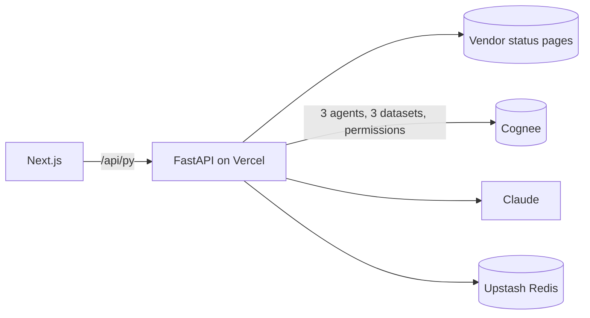

<div align="center">

# Clawback

**you're owed.** Clawback remembers every promise your vendors made, checks it against their own status page, and claims the credit you're owed.

Founder Square · Agents After Dark · UC Berkeley · Nov 16, 2026 · Nick + Darian

[Spec](docs/MVP.md) · [API](docs/API.md) · [Demo script](docs/DEMO.md) · [Backend tasks](docs/BACKEND.md) · [Frontend tasks](docs/FRONTEND.md)

</div>

## What it does

| | |
|---|---|
| **Remember** | Reads each vendor's SLA and your contracts: "99.9% a quarter, or 10% back." |
| **Audit** | Counts real downtime from the vendor's own public status page. GitHub Actions: 1,202 minutes down this quarter against a 99.9% promise. |
| **Claim** | Writes the claim email, citing the clause and every incident link. |
| **Learn** | When the vendor pushes back, it holds both stories side by side, you decide, and Cognee improves the agent (conflict review, session distillation, a skill rewrite). |
| **Share, safely** | Three agents (Auditor, Claims Writer, Inbox Assistant) share one Cognee memory with real permissions. The inbox agent can't read the negotiation playbook. |
| **Forget** | Paid credits are forgotten, so it never claims twice. |



## Run it

```bash
npm install
python3 -m pip install -r requirements-dev.txt
cp .env.example .env.local   # all optional: no keys = offline demo on real snapshots
npm run dev                  # http://localhost:3000 · API docs at /api/py/docs
npm test
```

## Limits

- Downtime comes from public status pages (major and critical incidents on covered services). Vendors measure with their own monitoring, so Clawback's number is the claim, not the verdict.
- The vendor reply and emails in `data/emails/` are written samples and say so. Status data and SLA terms are real and linked in `data/vendors/`.
