<div align="center">

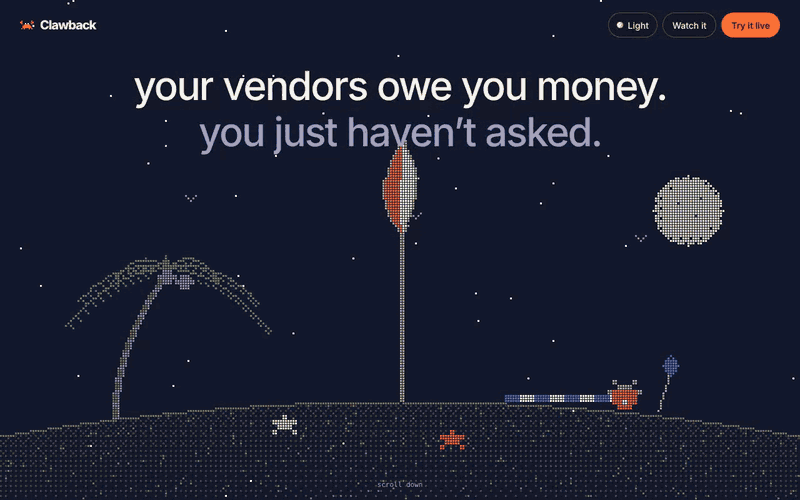

# Clawback

**Your vendors owe you money. Clawback gets it back.**

An agent that remembers every uptime promise your vendors made, checks it against their own status page,<br>
and writes the claim for the credit you're owed. Built on shared [Cognee](https://www.cognee.ai) memory that learns from every reply.

[**Try it live**](https://clawback-two.vercel.app/live) · [Watch the demo](https://clawback-two.vercel.app/demo) · [Landing page](https://clawback-two.vercel.app) · [Spec](docs/MVP.md) · [API](docs/API.md)

<sub>Built in one evening at Founder Square's Agents After Dark hackathon · UC Berkeley · Nov 16, 2026 · Nick + Darian</sub>

</div>

---

## Watch it work

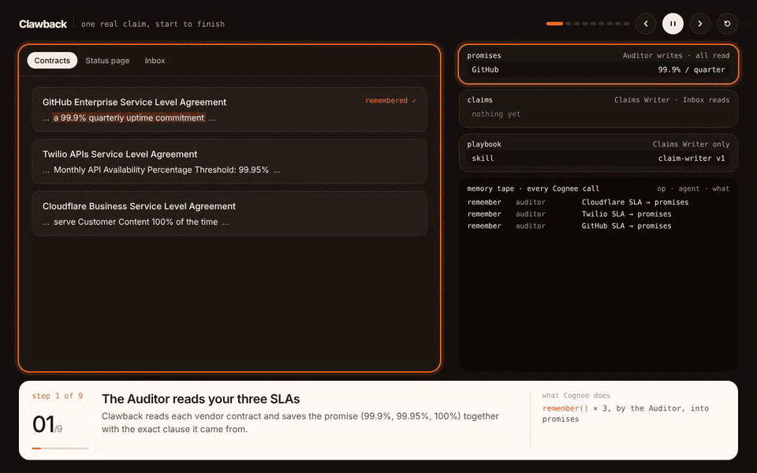

One real claim, start to finish. GitHub Actions was down **1,202 minutes** this quarter (99.09% against a promised 99.9%), so GitHub owes 10% back: **$630**. Every caption names the Cognee call behind that step.

<sub>Status data and SLA terms are real and linked in <code>data/vendors/</code>. The GitHub bill ($2,100 a month) and GitHub's reply are examples, and the app says so.</sub>

## What it does

<table>
<tr>
<td width="50%" valign="top">
<b>Finds the money.</b><br>
The Auditor reads each vendor's SLA, pulls their public incident history, counts the minutes that broke the promise and works out the credit. GitHub broke it. Twilio and Cloudflare kept theirs, so it asks them for nothing.<br><br>
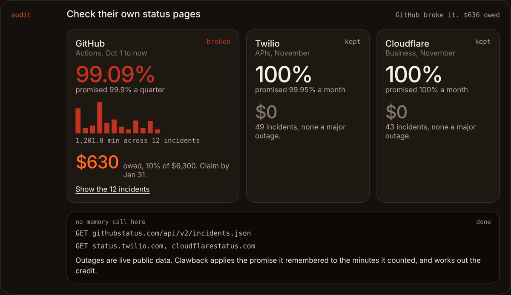
</td>
<td width="50%" valign="top">
<b>Handles pushback.</b><br>
GitHub replies that only 45 minutes count. Cognee keeps both answers with their sources and flags that they disagree. You pick the true one, with a reason, and that decision is saved as a lesson.<br><br>
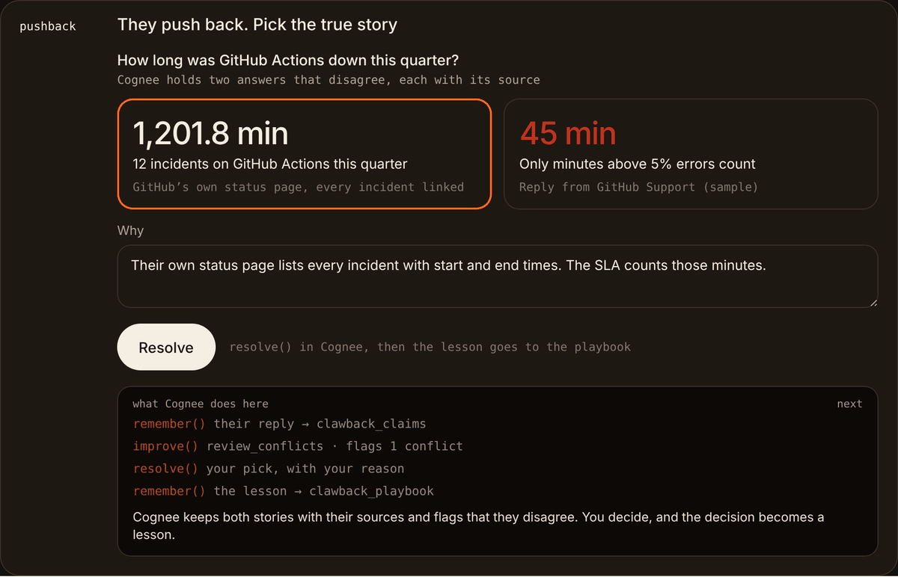
</td>
</tr>
<tr>
<td width="50%" valign="top">
<b>Improves itself.</b><br>
<code>improve()</code> distils the claim's session, and Cognee proposes a new version of the skill that writes claims. Apply it and the next claim is written by v2.<br><br>
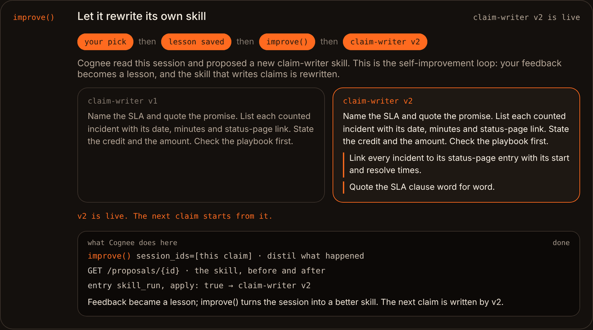
</td>
<td width="50%" valign="top">
<b>Shares memory, with permissions.</b><br>
Three agents (Auditor, Claims Writer, Inbox Assistant) use one memory split into three datasets. The Inbox Assistant talks to vendors, so it can't read the negotiation playbook. The red cells are real denials from Cognee.<br><br>
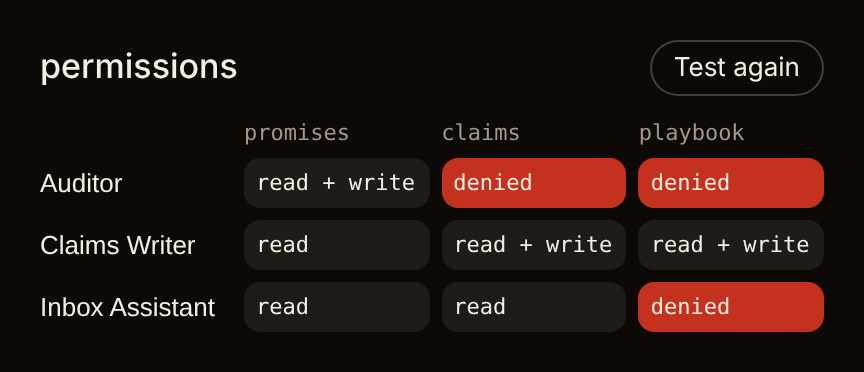
</td>
</tr>
<tr>
<td width="50%" valign="top">
<b>Forgets on purpose.</b><br>
Once the credit is paid, the claim, the reply and the working session are forgotten, and a one-line settled note stays so nobody claims twice.<br><br>
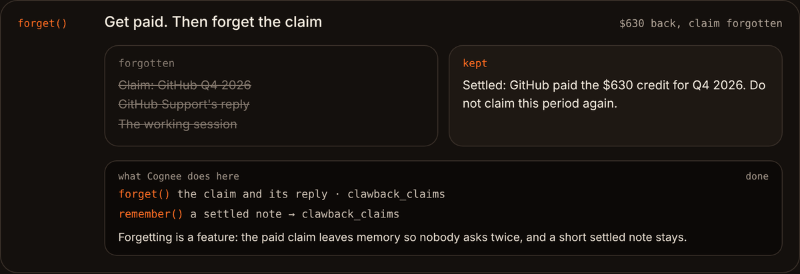
</td>
<td width="50%" valign="top">
<b>Survives its own death.</b><br>
Kill the agent. A brand-new one with no history recalls the promises, the settled credit, the lessons and the current skill, all from memory.<br><br>
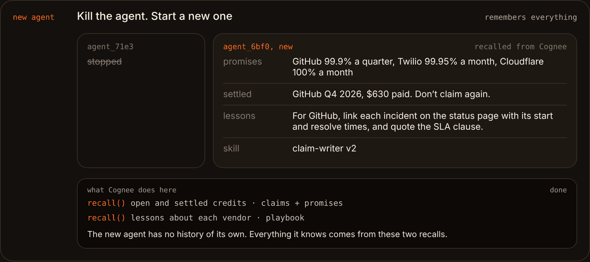
</td>
</tr>
</table>

## How it uses Cognee

Every memory call goes through [`server/clawback/memory.py`](server/clawback/memory.py) and lands on the **memory tape**, tagged with the agent that made it, so you can watch the memory change while the demo runs.

| Moment | Cognee call |
|---|---|
| Save each SLA promise with its source | `remember` → `clawback_promises` |
| Check the playbook before writing a claim | `recall` (Claims Writer → `clawback_playbook`) |
| Vendor pushes back | `remember` the reply → `improve` with conflict review → `conflicts` |
| You pick the true story | `conflicts/{id}/resolve`, then `remember` the lesson → `clawback_playbook` |
| Rewrite the claim-writer skill | `remember/entry` (a scored skill run) → `improve` on the session → proposal → `skills` (v2) |
| Credit paid | `forget` the claim, `remember` a settled note |
| New agent | `recall` open and settled credits, `recall` lessons |

<table>
<tr>
<td width="50%">

**Three datasets, three agents**

| Dataset | Holds | Who can read |
|---|---|---|
| `promises` | SLAs and status-page evidence | everyone |
| `claims` | claims, replies, settlements | Claims Writer, Inbox Assistant |
| `playbook` | lessons and the claim-writer skill | Claims Writer only |

Each agent is its own Cognee user with its own API key, and the grants are set in Cognee, so a denied read is Cognee saying no, not our code.

</td>
<td width="50%">
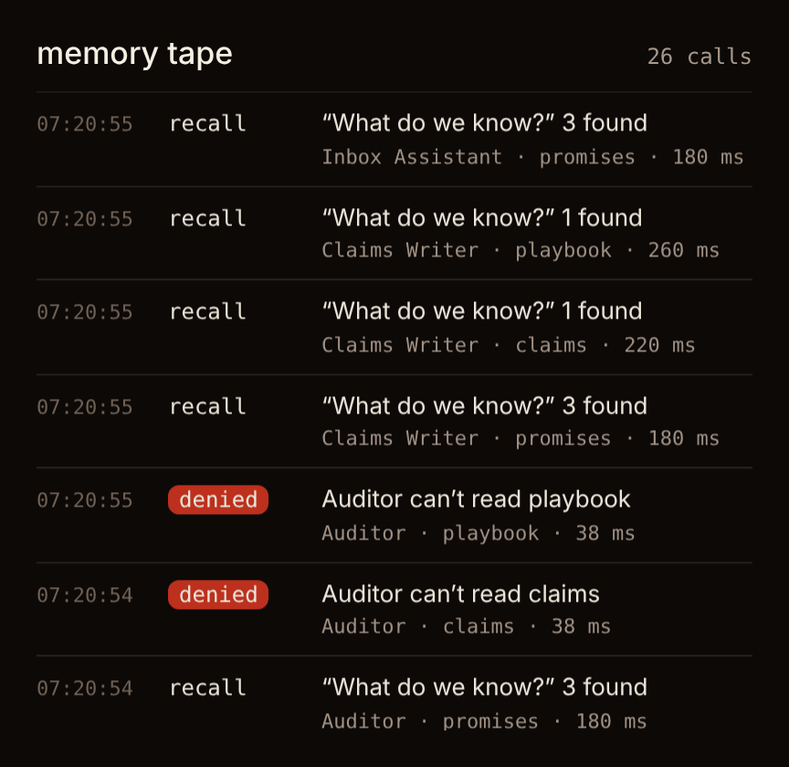
</td>
</tr>
</table>

## How it fits together

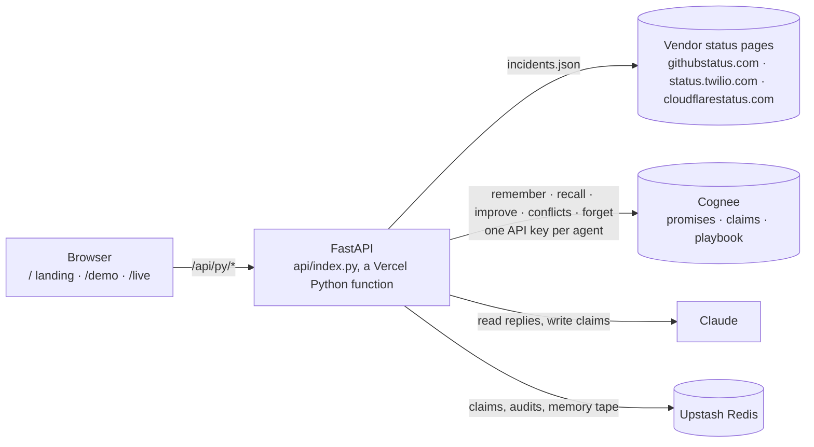

The pages are drawn on a pixel grid in plain HTML and canvas. The boards in [`design/`](design) are the source, and `python3 design/build_site.py` builds them into `public/site/`.

## Run it

```bash
npm install
python3 -m pip install -r requirements-dev.txt
cp .env.example .env.local   # every key is optional: with none, it runs offline on real status-page snapshots
npm run dev                  # http://localhost:3000 · API docs at /api/py/docs
npm test
```

| Page | What's there |
|---|---|
| `/` | The landing page: scroll down and the beach turns into the ocean |
| `/demo` | The 9-step captioned demo (the GIF above) |
| `/live` | The real flow, one button per step, against `/api/py` |

`/live` makes real calls when `/api/py/health` reports Cognee as connected, and otherwise replays a recorded live run (`data/demo/recorded.json`). Add `?demo=1` to force the replay or `?live=1` to force live calls. Light and dark mode carry across every page.

To connect Cognee, set `COGNEE_URL`, `COGNEE_API_KEY`, `COGNEE_DATASET` and `CLAWBACK_AGENT_KEYS` (see [`.env.example`](.env.example) and [`docs/BACKEND.md`](docs/BACKEND.md)). `POST /api/py/agents/setup` creates the three agents once; after that, `CLAWBACK_AGENT_KEYS` reuses them.

## Why we built it

**Problem.** A startup pays for dozens of tools, and each one promised uptime. When a vendor misses, the contract says you're owed a credit, but nobody claims it: it means digging up the SLA, counting incidents and writing to support before a deadline.

**Approach.** Make the agent's memory do the work. It holds every promise with its source, sets the vendor's own status page against what support says, learns how each vendor argues, and forgets a claim once it's paid.

**Trade-off.** We count downtime from public status pages (major and critical incidents on covered services, overlaps merged). Vendors measure with their own monitoring, so Clawback's number starts the claim. It doesn't settle it.

## Limits

- Live Cognee calls are slow: conflict review and the skill rewrite take 30 seconds to 2 minutes each. The page shows a timer, and `?demo=1` replays a recorded run if anything breaks.
- The vendor reply and the emails in `data/emails/` are written samples and say so. The GitHub bill is an example (100 seats).
- Three vendors so far. Any vendor on Atlassian Statuspage would be quick to add.

<div align="center">
<br>
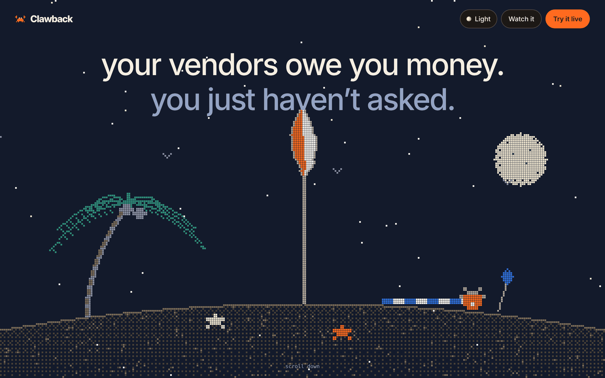
<br>
<sub>Nick (frontend and design) · Darian (backend and Cognee)</sub>
</div>
