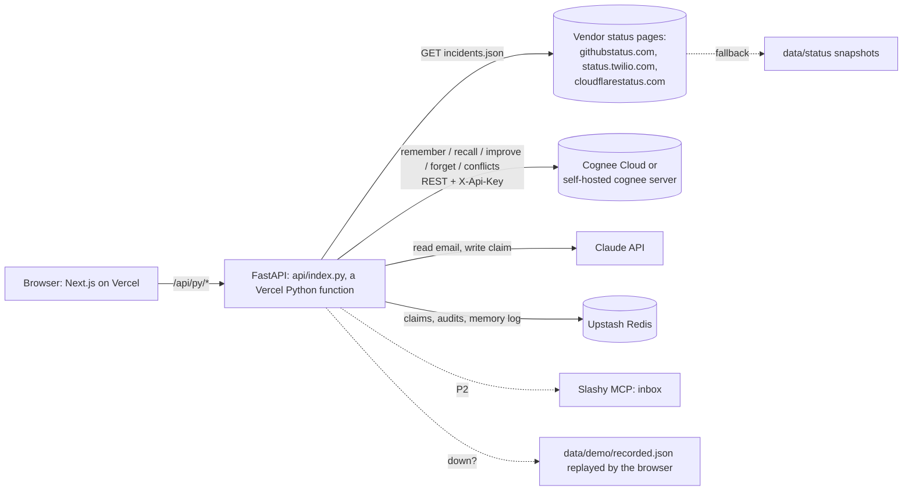

# Clawback MVP

**Your vendors broke their promises. Clawback remembers every one, checks it against the vendor's own status page, and claims the credit you're owed.**

Built tonight at Founder Square's Agents After Dark (UC Berkeley, Nov 16, 4–9 PM) by Nick (frontend + design) and Darian (backend).
Targets: **Best Overall** (Founder Square) and **Best Use of Cognee** (Cognee).
Judged on: innovation, technical execution, real-world impact and the final demo.

---

## 1. What it does

- You give it your vendors (GitHub, Twilio, Cloudflare to start) and any contract or email that mentions a promise.
- It remembers every promise, like "99.9% uptime a quarter, or 10% back."
- It reads each vendor's public status page and counts the real downtime.
- When a promise was broken, it shows how much you're owed and writes the claim email, citing the clause and each incident.
- When the vendor pushes back, it holds both stories side by side. You pick one and it learns how that vendor argues.
- When the credit is paid, it forgets that claim so it never asks twice.
- Kill the agent mid-demo and a new one picks up from memory alone.

**Why people care:** startups pay for dozens of tools, and nobody tracks what each one promised. Credits go unclaimed because claiming them is tedious, needs evidence, and has a 30-day deadline.

## 2. How we win each prize

| Criterion | What judges see |
|---|---|
| Real-world impact | A dollar figure from real data. **GitHub, Oct 1 to Nov 16: GitHub Actions was down 1,202 minutes (99.09%) against a 99.9% promise, so 10% back: $630 on a $6,300 quarter.** Twilio and Cloudflare come back clean, which shows it doesn't cry wolf. |
| Innovation | Today this is done by hand or not at all. Here an agent finds, proves and claims the money, and learns each vendor's habits. |
| Technical execution | Live status feeds, SLA math checked by tests, Cognee memory with conflict review, a deployed app, and a fallback so the demo can't fail. |
| Demo quality | One story, 90 seconds, ending on money and a memory moment (docs/DEMO.md). |
| **Best Use of Cognee** | The three things the Cognee team asked for, each as a moment in the demo: **self-improvement** (`improve()` + a skill Cognee rewrites), **shared memory across agents** (3 Cognee agents, 1 memory) and **permissions** (the inbox agent is denied the playbook). Section 6. The memory tape shows every call, and which agent made it. |

Past Cognee winners all showed **memory that changes**: Lethe won by forgetting, FALSIFY by revising wrong beliefs, Synapse by spotting contradictions with provenance. Their judges said they didn't want a wrapper. Clawback does all three, and they matter to the product: the contested claim is a contradiction, the vendor lesson is a revision, and the paid claim is a forget.

## 3. Team, branches, rules

| | Nick | Darian |
|---|---|---|
| Owns | `app/`, `lib/` (frontend), `public/`, design, demo video, README | `api/`, `server/`, `data/`, `scripts/`, `tests/`, Vercel env + Cognee |
| Branch | `nick/frontend` | `darian/backend` |

- `main` is what Vercel deploys to production. Every push to another branch gets its own preview URL.
- Merge to `main` through a PR, with the other person's 👍. Small PRs, every hour.
- **The contract is `docs/API.md`.** It's mirrored in `server/clawback/models.py` (Darian) and `lib/types.ts` (Nick). Change a field? Change both files in the same PR and tell the other person.
- Nick never edits `api/` or `server/`; Darian never edits `app/`. `AGENTS.md` repeats this for coding agents.

## 4. Scope

**P0: the demo can't happen without these**
1. Vendors and their promises (3 verified SLAs in `data/vendors/`) ✅ scaffolded
2. Audit: status feed → counted incidents → uptime → credit → $ owed ✅ scaffolded + tested
3. Claim email drafted from the audit (Claude, template fallback) ✅ scaffolded
4. Cognee connected (Cloud or self-hosted); `remember` / `recall` live, memory tape on screen ⏳ Darian
5. The screens: landing → receipts → claim → contested → paid ⏳ Nick
6. Deployed on Vercel, with recorded-run fallback ✅ fallback in place, deploy ⏳

**P1: what wins Cognee (the judges named these three)**
7. **Shared memory across agents + permissions:** `POST /agents/setup` creates 3 datasets, 3 Cognee agents with their own keys, and the grants; `GET /agents/permissions` shows the Inbox Assistant denied the playbook ✅ scaffolded, needs a live Cognee test
8. **Self-improvement:** pushback → `improve(review_conflicts)` → `conflicts` → human resolves → lesson + feedback → skill run scored → Cognee proposes a SKILL.md rewrite → human applies → `improve(session_ids)` distils the session ✅ scaffolded, needs a live Cognee test
9. Paid → `forget` ✅ scaffolded
10. Kill the agent → new agent briefed from `recall` only ✅ scaffolded
11. Paste an email → promises extracted (`/ingest`) ✅ scaffolded

**P2: only if ahead**
12. Slashy inbox: pull vendor emails and push the claim draft into the inbox over Slashy MCP (`server/clawback/inbox.py`, stubbed)
13. Scripted demo player (`/demo?auto`) for the booth
14. A fourth vendor (any Atlassian Statuspage: Vercel, Datadog, Supabase…)

**Cut order if behind:** 14 → 13 → 12 → 11 → 10. Never cut the dollar figure, the memory tape, the permissions moment, or contested → learn → improve → forget.

## 5. Architecture



- **One repo, one Vercel project, one URL.** Next.js at the root; `next.config.mjs` rewrites `/api/py/*` to the Python function (uvicorn on :8001 locally).
- **Cognee over REST, not the Python package.** The function only needs `fastapi`, `httpx`, `pydantic`, so it stays far under Vercel's 500 MB Python limit. The endpoints are the same ones `cognee.serve()` uses.
- **Everything external has a fallback:** status page → snapshot, Cognee → offline memory (labelled "offline" on screen), Claude → rules/templates, whole API → recorded run in the browser.

## 6. Cognee: the three things judges asked for

The Cognee team said they're looking for **self-improvement (`.improve()`)**, **shared memory across agents** and the **permission system**. Each one is a visible moment in the demo, and each one is load-bearing: take it out and the product breaks.

### 6a. Shared memory across agents

Three agents work one claim. Each is a real Cognee agent user (`POST /api/v1/agents/create?name=…`) with its own API key, and every call it makes goes out under that key. All three read and write the same memory:

| Agent | Job | Writes to |
|---|---|---|
| **Auditor** | reads SLAs and status pages | `clawback_promises` |
| **Claims Writer** | drafts and defends claims, learns each vendor's habits | `clawback_claims`, `clawback_playbook` |
| **Inbox Assistant** | handles vendor email (Slashy, P2) | nothing; reads claims |

The Claims Writer drafts from what the Auditor remembered, and the "kill the agent" beat proves it: a brand-new Claims Writer picks up from shared memory alone.

### 6b. Permissions

Three datasets, granted per agent through `POST /api/v1/permissions/datasets/{agent_id}?permission_name=read|write|delete|share`:

| | promises | claims | playbook (our negotiation notes) |
|---|---|---|---|
| Auditor | read, write | ✕ | ✕ |
| Claims Writer | read | read, write, delete | read, write |
| Inbox Assistant | read | read | **✕** |

**Demo line:** "The Inbox Assistant talks to vendors, so it must never see our playbook." Click **Agents + permissions** and that cell comes back red, denied by Cognee, not by our code. The table lives in `server/clawback/memory.py` (`ACL`) and `agents.setup()` writes it into Cognee. Offline mode enforces the same table locally.

### 6c. Self-improvement

After every outcome the agent gets better, three ways, all through Cognee:
1. **Conflict review:** the vendor's reply is remembered next to the status-page evidence, then `improve(review_conflicts=true)` checks them against each other. A human picks a fact with `POST /api/v1/conflicts/{id}/resolve`.
2. **Feedback + session distillation:** a feedback entry scores the agent's earlier answer, then `improve(session_ids=[claim session])` distils the claim's working memory into the permanent graph (feedback weights, QA persistence, distillation stages).
3. **Skill rewrite:** the `claim-writer` skill (`data/skills/claim-writer/SKILL.md`, ingested at setup via `POST /api/v1/skills`) gets a scored `skill_run` entry. A pushback scores 0.4, so Cognee **proposes a rewrite**. The UI shows the before/after (`GET /api/v1/proposals/{id}`) and the human applies it.

**Proof on screen:** the second claim to GitHub is visibly different. It cites incident links with start and end times, because that's the lesson from the first fight.

### Every Cognee call

| Moment in the demo | Agent | Call | REST |
|---|---|---|---|
| Setup | owner | datasets, agents, grants, skill | `POST /api/v1/datasets` · `/agents/create` · `/permissions/datasets/{id}` · `/skills` |
| Read the SLAs | Auditor | `remember` → promises | `POST /api/v1/remember` multipart `data`, `datasetName`, `node_set` |
| Draft a claim | Claims Writer | `recall` lessons (playbook + promises), `remember` claim, session note, QA entry | `POST /api/v1/recall` · `/remember` · `/remember/entry` |
| Vendor pushes back | Claims Writer | `remember` reply, `improve(review_conflicts)`, `conflicts` | `POST /api/v1/improve` · `GET /api/v1/conflicts?dataset_id=` |
| Human decides | Claims Writer | `resolve`, lesson → playbook, feedback, skill_run, `improve(session_ids)` | `POST /api/v1/conflicts/{id}/resolve` · `/remember/entry` |
| Apply skill rewrite | Claims Writer | skill_run with `apply: true` | `POST /api/v1/remember/entry` |
| Credit paid | Claims Writer | `forget` the claim, remember "settled" | `POST /api/v1/forget {dataId, dataset}` |
| Kill the agent | new Claims Writer | `recall` only | `POST /api/v1/recall` |
| Permissions check | all three | `recall` on each dataset | 403 → red on the tape |

Auth is the `X-Api-Key` header (the owner key from `COGNEE_API_KEY`, or each agent's own key). JSON bodies accept camelCase or snake_case.

**Getting a Cognee server (Darian, first 20 minutes):**
1. **Ask the Cognee team at the event for a Cognee Cloud URL + API key.** At past events they handed these out, and Cloud use scored extra. Put them in `COGNEE_URL` / `COGNEE_API_KEY`.
2. Otherwise self-host: `pip install cognee`, set `LLM_API_KEY`, run `uvicorn cognee.api.client:app --port 8000`. Expose it to Vercel with `cloudflared tunnel --url http://localhost:8000`. If you get 401s, log in at `POST /api/v1/auth/login` and create a key at `POST /api/v1/auth/api-keys`.
3. Neither works? The app runs on offline memory and says so on screen. The demo still runs, but the Cognee prize needs the real thing.

## 7. Data (real, checked against the source pages)

| Vendor | Promise | Credit | Claim by | Source |
|---|---|---|---|---|
| GitHub Enterprise Cloud | 99.9% a quarter, per service | 10% at or below 99.9%, 25% below 99.0%, of what was paid for the affected service | 30 days after quarter end | [GitHub Enterprise SLA](https://docs.github.com/en/site-policy/site-policy-deprecated/github-enterprise-service-level-agreement) (pre-2021 contracts; newer ones point to github.com/customer-terms) |
| Twilio APIs | 99.95% a month | 10% of the affected API fees below 99.95% | 30 days after month end; future-invoice credit | [Twilio APIs SLA](https://www.twilio.com/en-us/legal/service-level-agreement/twilio-apis) |
| Cloudflare Business | 100% | outage minutes × affected share ÷ minutes in month × monthly fee; cap 1 month of fees a year | notice within 5 business days, claim by end of next billing month | [Cloudflare Business SLA](https://www.cloudflare.com/business-sla/) |

- Status feeds: `{statusPage}/api/v2/incidents.json` (the last 50 incidents; public, no key). Real snapshots from tonight are in `data/status/`. Refresh them with `npm run snapshot`.
- Counting rule: only `major` and `critical` incidents on covered services count; overlaps count once; GitHub is judged per service (worst one). Example fees are labelled "example" in the vendor files. In the UI the user types their real fee.
- Sample emails in `data/emails/` are fictional and say so.

## 8. Tonight's timeline (adjust live)

| Time | Darian (backend) | Nick (frontend + design) |
|---|---|---|
| 4:30–5:00 | Pull `main`, `npm run dev`, get Cognee Cloud keys, set Vercel env, `POST /api/py/agents/setup` once | Import repo to Vercel, design canvas: visual thesis + 5 screens |
| 5:00–6:00 | Cognee live: seed, audit, draft hitting real `remember`/`recall`; fix response parsing | Landing + receipts screens against the API (or replay) |
| 6:00–7:00 | Pushback → `improve` → `conflicts` → resolve → skill proposal on live Cognee; check the permissions 403; Claude key in | Claim + contested + paid screens; memory tape styled |
| 7:00–7:45 | `npm run snapshot`, `npm run record` (real run), deploy, test on the Vercel URL | Handoff moment, phone + desktop check, unslop pass |
| 7:45–8:30 | Freeze. Rehearse the 90-second demo twice. Record a backup video. README hero shot. Submit. | |

## 9. Run it

```bash
git clone https://github.com/nick-devvv/clawback && cd clawback
npm install
python3 -m pip install -r requirements-dev.txt
cp .env.example .env.local        # fill what you have; nothing is required
npm run dev                       # web on :3000, API on :8001 (http://localhost:3000/api/py/docs)
npm test                          # backend tests (SLA math + the whole flow offline)
```

Vercel: Import the repo → Framework "Next.js" (auto) → add env vars from `.env.example` → Deploy. Add **Upstash for Redis** from the Vercel Marketplace so claims survive between requests (the KV_* variables fill in). Every branch push gets a preview URL.

## 10. Risks and fallbacks

| Risk | Fallback already built |
|---|---|
| Cognee slow (graph building takes seconds) | Seed before the demo; session-tier calls are fast; `remember` has a 120s timeout; Vercel `maxDuration` 300 |
| Cognee conflict review finds nothing | Clawback builds the conflict itself from the two sources (status page vs reply) and still records the decision in Cognee |
| A status page is down | `data/status` snapshots |
| No Claude key | Rules extract promises, a template writes the claim |
| Vercel Python function misbehaves | Run the API anywhere (`uvicorn`), set `NEXT_PUBLIC_API_BASE` to it |
| Wi-Fi dies on stage | The browser replays `data/demo/recorded.json` automatically |

## 11. Honest limits (say them before a judge asks)

- Vendors measure downtime with their own monitoring. The status page is the customer's best evidence, so Clawback's number is a claim, not a verdict.
- The GitHub SLA on the public page covers older contracts; real contracts vary. That's why `/ingest` reads your own contract.
- Status feeds return the last 50 incidents, so long windows need snapshots saved over time.
- In-progress windows show the best case so far: downtime can only grow.

## 12. Slashy (P2)

Slashy is an AI email client with an MCP server ("Slashy MCP"), free for a month for the event. It fits Clawback's inbox: vendor promises arrive by email, and claims leave by email. Plan: Darian gets the MCP URL + token from the Slashy team, then implements `vendor_emails()` and `create_draft()` in `server/clawback/inbox.py` (MCP `tools/list` → `tools/call`). Demo line: "the claim is already waiting in your inbox, in Slashy."
